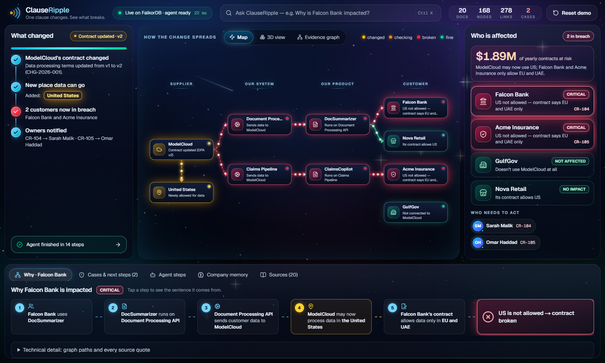
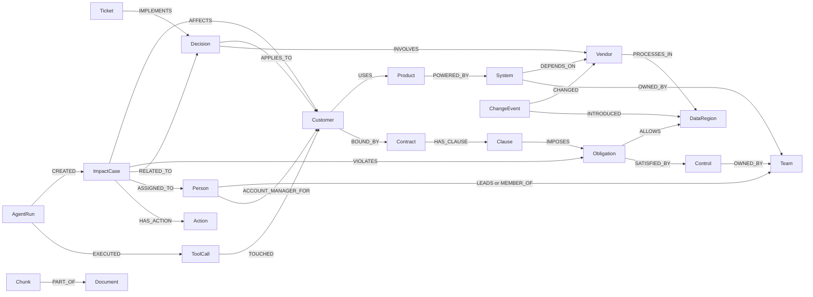

# ClauseRipple

**One clause changes. See what breaks.**

ClauseRipple is an AI change impact agent powered by **FalkorDB**.

When a vendor changes one clause in a contract, ClauseRipple follows the company graph to find every system,
product, customer, contract and owner that the change affects. Then it acts: it recalls what the company decided
last time, opens an impact case, assigns it to the right person, and shows the source sentence behind every step.

> **Vector search finds the changed clause. FalkorDB finds the consequences.**



- **Live demo:** https://clause-ripple.vercel.app (free hosting; the first load can take about a minute while the API wakes up)
- Built for **Graph Hacks: Context for AI Agents** (FalkorDB x WeMakeDevs)
- Tracks: **Track 01: Agents That Act on Connected Data** and **Track 03: Company Brain**
- All demo data is synthetic. No real company data is used.
- Quick links: [90 second demo script](docs/demo/90-second-script.md) · [Architecture](docs/architecture/overview.md) ·
  [Benchmark](docs/benchmark.md) · [All Cypher queries](docs/cypher/) · [AI assistance](AI_ASSISTANCE.md)

---

## Contents

1. [What ClauseRipple does](#what-clauseripple-does)
2. [Why this is a graph problem](#why-this-is-a-graph-problem)
3. [How FalkorDB is used](#how-falkordb-is-used)
4. [Graph model](#graph-model)
5. [The agent](#the-agent)
6. [Rules decide, not the LLM](#rules-decide-not-the-llm)
7. [Company memory](#company-memory)
8. [Source evidence](#source-evidence)
9. [What you see on screen](#what-you-see-on-screen)
10. [Demo flow](#demo-flow)
11. [Core Cypher](#core-cypher)
12. [Architecture](#architecture)
13. [Benchmark](#benchmark)
14. [What is real and what is not](#what-is-real-and-what-is-not)
15. [Local setup](#local-setup)
16. [Tests](#tests)
17. [Hackathon tracks](#hackathon-tracks)
18. [Built with](#built-with)
19. [AI assistance](#ai-assistance)
20. [Synthetic data](#synthetic-data)

---

## What ClauseRipple does

AtlasAI is a fictional company that sells AI products to banks, insurers, retailers and government.
One of its vendors, **ModelCloud**, publishes a new Data Processing Addendum (DPA).

| | Where ModelCloud may process customer data |
|---|---|
| DPA v1 (before) | UAE, EU |
| DPA v2 (after) | UAE, EU, **United States** |

It looks like one small change. But some AtlasAI customers have contracts that say their data must stay in the
UAE or the EU. Nobody can see that conflict from one document. ClauseRipple finds it.

When the new DPA arrives, ClauseRipple:

1. **Updates the graph.** It compares v1 and v2 and adds exactly one new fact to FalkorDB:
   `ModelCloud -PROCESSES_IN-> United States`. The change is saved as a `ChangeEvent`.
2. **Starts the agent.** The Change Impact Agent calls graph tools over **MCP**. Each tool runs Cypher on FalkorDB.
3. **Follows the connections.** Which systems depend on ModelCloud? Which products run on those systems?
   Which customers use those products? Which contract clauses apply to those customers?
4. **Decides with a rule.** A customer is in breach only if it really depends on ModelCloud **and** ModelCloud
   now uses a region its contract does not allow.
5. **Remembers.** It finds an earlier company decision, **CR-087**, about Falcon Bank and ModelCloud.
6. **Finds the owner.** It follows ownership links to **Sarah Malik, Platform Engineering**.
7. **Acts.** It writes impact cases **CR-104** (Falcon Bank) and **CR-105** (Acme Insurance) into FalkorDB,
   with next steps, and assigns them.
8. **Explains.** Every step links to the document and the exact sentence it came from.

### The result

| Customer | Result | Why |
|---|---|---|
| Falcon Bank | **Impacted, critical** | Uses ModelCloud through DocSummarizer. Its contract allows only UAE and EU. |
| Acme Insurance | **Impacted, critical** | Uses ModelCloud through ClaimsCopilot. Its contract allows only UAE and EU. |
| Nova Retail | Not impacted | Uses ModelCloud, but its contract allows US processing. |
| GulfGov | Not impacted | None of its products connect to ModelCloud at all. |

ClauseRipple does not flag every customer. It checks each one against the real graph, and it can prove why the
safe customers are safe.

---

## Why this is a graph problem

A normal RAG system can answer: *"What changed in ModelCloud's contract?"*

The harder question is: *"Which customers are now in breach because of it?"*

That answer is not in any single document. It is spread across five documents and only appears when you connect
them. Falcon Bank has two paths that meet at the data regions:

```text
Dependency path (does Falcon Bank use ModelCloud?)
Falcon Bank -USES-> DocSummarizer -POWERED_BY-> Document Processing API -DEPENDS_ON-> ModelCloud

Contract path (where may Falcon Bank's data go?)
Falcon Bank -BOUND_BY-> Falcon Bank MSA -HAS_CLAUSE-> Clause 7.2 -IMPOSES-> Data residency -ALLOWS-> UAE, EU

The change
ModelCloud -PROCESSES_IN-> United States   (new in DPA v2)
```

The same vendor change breaks Falcon Bank, is fine for Nova Retail, and cannot reach GulfGov.
In our [benchmark](#benchmark), plain vector search got all the needed evidence for only 2 of 12 questions.
The graph got it for 11 of 12.

---

## How FalkorDB is used

FalkorDB is the only database in ClauseRipple. It is not a side feature or a visual layer.

It stores the company knowledge (customers, products, systems, vendors, regions, contracts, clauses, obligations,
controls, teams, people, decisions, tickets, documents and text chunks with embeddings) **and** the agent's own
memory (change events, impact cases, actions, agent runs and tool calls).

Every tool the agent calls is a Cypher query that runs against FalkorDB while the agent is working.

| If FalkorDB is removed | Because |
|---|---|
| The blast radius cannot be found | `Customer -> Product -> System -> Vendor` is a live multi-hop traversal |
| No customer can be checked | Allowed regions come from `Contract -> Clause -> Obligation -> Region` |
| GulfGov cannot be cleared | "Not impacted" is proven by a bounded `shortestPath` that finds no path |
| Cases cannot be assigned | Owners come from `System -OWNED_BY-> Team <-LEADS- Person` |
| The agent forgets | Decisions, cases, approvals and runs are graph nodes |
| Evidence disappears | Each relationship stores its source document, line and exact quote |
| The 3D view goes dark | RippleSpace draws the live graph |
| Ask ClauseRipple cannot answer | The vector index, full-text index and answer paths are all in FalkorDB |

If FalkorDB is down, the UI says **"FalkorDB unavailable. Agent reasoning paused."** There is no backup store.

---

## Graph model

ClauseRipple uses **20 node labels** (defined in [`apps/api/app/graph/ontology.py`](apps/api/app/graph/ontology.py)).
The baseline demo graph has **144 nodes and 173 relationships**, built from **20 source documents**.



### Node labels

| Group | Label | What it is |
|---|---|---|
| Company knowledge | `Customer` | A company that buys AtlasAI products |
| | `Product` | Something AtlasAI sells, like DocSummarizer |
| | `System` | An internal service that powers products, like Document Processing API |
| | `Vendor` | An outside supplier, like ModelCloud |
| | `DataRegion` | A place where data may be processed: UAE, EU, US |
| | `Contract` | A customer agreement (MSA) |
| | `Clause` | One numbered clause in a contract |
| | `Obligation` | What a clause requires, like data residency or change notice |
| | `Control` | An internal control that satisfies an obligation |
| | `Team` | A team that owns systems and controls |
| | `Person` | An employee: team lead, member or account manager |
| | `Decision` | A past company decision, like CR-087 |
| | `Ticket` | Work that implements a decision |
| | `Document` | A source document (contract, DPA, architecture doc, directory) |
| | `Chunk` | A piece of a document, with an embedding for search |
| Agent memory | `ChangeEvent` | A detected change, like the new DPA |
| | `ImpactCase` | A case the agent opens, like CR-104 |
| | `Action` | A next step inside a case, each with an owner |
| | `AgentRun` | One run of the agent |
| | `ToolCall` | One tool call inside a run |

Every node has a stable `id` such as `customer:falcon-bank`. Relationships that come from documents carry
`src`, `src_ver`, `line`, `loc` and the exact `quote`.

---

## The agent

The Change Impact Agent does not guess facts. It calls tools, and every tool reads or writes FalkorDB.

```text
DPA v2 arrives
  -> graph update (+1 fact) and ChangeEvent CHG-2026-001
  -> agent starts
  -> inspect_change -> trace_vendor_dependents -> find_impacted_customers -> evaluate_residency
  -> for each impacted customer:
       recall_related_decisions -> find_owner -> get_source_evidence
       -> create_impact_case (graph write) -> assign_impact_case (graph write)
  -> AgentRun -EXECUTED-> ToolCall -TOUCHED-> entities   (saved, can be replayed)
```

**The LLM picks the tools. The tools return the facts. Rules decide who is in breach.**

### Tools (served over MCP)

The same 10 tools are available three ways: to the built-in agent through an MCP client, over streamable HTTP
at `/mcp`, and over stdio (`uv run python -m app.mcp_server`).

| Tool | What it does in the graph |
|---|---|
| `inspect_change` | Reads the ChangeEvent: which document, which entity, which facts were added or removed |
| `trace_vendor_dependents` | Finds systems that depend on a vendor (`DEPENDS_ON*1..4`) |
| `find_impacted_customers` | Finds customers connected to those systems through products |
| `get_customer_obligations` | Reads data residency and notice clauses, with quotes |
| `evaluate_residency` | Gives a rule based verdict for every customer, with proof when there is no path |
| `recall_related_decisions` | Finds past decisions about the same customer or vendor |
| `find_owner` | Finds the team and person who own a system |
| `get_source_evidence` | Returns both paths and the vendor regions, with a quote on every edge |
| `create_impact_case` | **Writes** an ImpactCase and its Actions. Refuses if the graph shows no breach. |
| `assign_impact_case` | **Writes** the assignment. Refuses anyone outside the owning team. |

Connect any MCP client to the running API, for example Claude Code:

```bash
claude mcp add --transport http clauseripple http://localhost:8000/mcp
```

### Safety checks

- `create_impact_case` checks the rule again against the live graph. Try to open a case for Nova Retail and the
  graph refuses. You can try this from the *Why* tab.
- `assign_impact_case` only accepts a person who leads or belongs to the team that owns an affected system.
- Every tool argument is checked against a JSON schema before any Cypher runs.
- No chain of thought is stored. Only the tool, its input, a result summary, the entities it touched and timings.

### Which model runs it

The planner is pluggable ([`apps/api/app/agent/planners.py`](apps/api/app/agent/planners.py)):
Anthropic Claude, any OpenAI compatible endpoint (OpenAI, Gemini, Groq, OpenRouter), or a free local Ollama model.
With no LLM configured, a clearly labelled **deterministic playbook** calls the same tools in the same order,
so the demo always works. The UI always shows which planner ran. If an LLM stops early, the playbook finishes
the missing cases and the trace says so.

---

## Rules decide, not the LLM

ClauseRipple never asks an LLM *"Is this customer compliant?"* It uses a simple rule:

```text
violating regions = vendor processing regions - customer allowed regions

ModelCloud processes in:  UAE, EU, US
Falcon Bank allows:       UAE, EU
Violating regions:        US   -> Falcon Bank is impacted
```

A customer is impacted only if a dependency path to the vendor exists **and** there is at least one violating
region. The LLM can explain the result. It does not decide it.

---

## Company memory

- Past decisions (CR-087, CR-095, CR-103) and a ticket (PLAT-481) are stored as `Decision` and `Ticket` nodes,
  linked to the customers, vendors, systems and people they involve.
- `recall_related_decisions` ranks decisions by how much they share with the case. For Falcon Bank it finds
  CR-087 (*"Falcon Bank workloads must remain pinned to UAE/EU processing whenever ModelCloud's regional scope
  changes"*). For Acme it only finds a weaker vendor match, so the two cases get different advice.
- When a person clicks **Approve remediation**, the approval is written back as a new `Decision` node
  (for example CR-106) linked to the case. The next agent run can recall it.
- Every run is saved as `AgentRun -EXECUTED-> ToolCall -TOUCHED-> entity`. Close the browser or restart the API
  and the cases, decisions and runs are read back from FalkorDB.

### Example impact case

```text
CR-104  ModelCloud regional processing change
Customer:          Falcon Bank          Severity:  Critical
Product:           DocSummarizer        System:    Document Processing API
Violating region:  US                   Allowed:   EU, UAE
Owner:             Sarah Malik          Team:      Platform Engineering
Related memory:    CR-087
Next steps:        keep workloads pinned to EU/UAE, review the DPA change, prepare written notice to the customer
```

The case is a real node in FalkorDB, linked to the customer, the broken obligation, the decision and the owner.
It is not just generated text.

---

## Source evidence

Every important relationship remembers where it came from. For example:

```text
Document Processing API -DEPENDS_ON-> ModelCloud
Source: document_processing_architecture.md
Quote:  "The Document Processing API routes model inference requests through ModelCloud."
```

Ingestion is rule based and provenance first ([`apps/api/app/ingest/extractor.py`](apps/api/app/ingest/extractor.py)):

- Entities come from catalog, CRM and directory documents. Relationships come from sentence and table rules.
- Negative sentences like "does not call ModelCloud" create no edge.
- Every quote is checked word for word against its document before it is written.
- After every reset, 20 critical facts are checked against the live graph. If one is missing, the reset reports
  a failure. Nothing is patched in by hand.

---

## What you see on screen

- **Left: What changed.** The contract change in plain words, and the progress of the agent.
- **Center: How the change spreads.** Three views of the same live graph:
  - **Map**: Supplier -> Our system -> Our product -> Customer, colored as the agent finds things.
  - **3D view (RippleSpace)**: the whole FalkorDB graph in 3D, built with three.js and React Three Fiber.
  - **Evidence graph**: the dependency path and the contract path meeting at the regions, with a clear
    `✕ US not allowed` edge.
- **Right: Who is affected.** A verdict for every customer, the money at risk, and who needs to act.
- **Bottom:** *Why* (numbered steps, each with its source sentence), *Cases & next steps*, *Agent steps*,
  *Company memory* and *Sources*.
- **Ask ClauseRipple** (`Ctrl+K`): ask a question in plain English and get an answer from the graph, with sources.

RippleSpace is not a decorative background. The nodes and links come from FalkorDB, and the ripple follows the
same path order the graph returns: ModelCloud, then systems, then products, then customers, then obligations and
owners. Impacted nodes turn red, safe ones green. It falls back to a 2D view if WebGL is not available.

---

## Demo flow

About 90 seconds. Full script with narration: [`docs/demo/90-second-script.md`](docs/demo/90-second-script.md).

1. **Reset demo.** ModelCloud processes data only in UAE and EU. Every customer is fine.
2. **Click Falcon Bank.** The *Why* tab shows Falcon Bank -> DocSummarizer -> Document Processing API -> ModelCloud,
   and its contract allowing only UAE and EU.
3. **Click "Apply the new contract".** ModelCloud DPA v2 adds US processing.
4. **Watch the agent.** It traces dependencies, checks contracts, recalls CR-087 and finds the owner.
   Falcon Bank and Acme Insurance turn red. Nova Retail and GulfGov stay green.
5. **Open *Cases & next steps*.** CR-104 for Falcon Bank, assigned to Sarah Malik, with next steps.
6. **Open the evidence.** Click any *Why* step to see the exact source sentence, or open the *Evidence graph*.
7. **Approve remediation.** The approval becomes a new decision in the graph.
8. **Ask:** *"What did we decide about Falcon Bank after the ModelCloud policy change?"*

Screenshots of every step: [`docs/demo/screenshots/`](docs/demo/screenshots/).

---

## Core Cypher

All Cypher lives in [`docs/cypher/`](docs/cypher/) and **the API loads it from there at runtime**. The queries in
the docs are the queries that run. A test fails if any documented query is not used.

```cypher
// 02_customer_blast_radius.cypher: every customer that reaches a vendor
MATCH (v:Vendor {id: $vendor_id})
MATCH path = (c:Customer)-[:USES]->(p:Product)-[:POWERED_BY]->(s:System)-[:DEPENDS_ON*1..4]->(v)
RETURN c.name, p.name, s.name, length(path) AS hops,
       [r IN relationships(path) | {type: type(r), src: r.src, quote: r.quote}] AS evidence

// 02: proof that there is no path (why GulfGov is safe)
MATCH (c:Customer {id: $customer_id}), (v:Vendor {id: $vendor_id})
WITH c, v
RETURN shortestPath((c)-[:USES|POWERED_BY|DEPENDS_ON*1..6]->(v)) AS path

// 04_owner_lookup.cypher: who owns the affected system
MATCH (s:System {id: $system_id})-[:OWNED_BY]->(t:Team)
OPTIONAL MATCH (lead:Person)-[:LEADS]->(t)
RETURN t.name, lead.name
```

| File | Purpose |
|---|---|
| `00_schema` | Indexes on every label, full-text indexes (chunks, decisions), vector index (chunks) |
| `01_vendor_dependents` | Systems that depend on a vendor; where the vendor processes data |
| `02_customer_blast_radius` | Multi-hop blast radius; `shortestPath` proof of no path |
| `03_customer_obligations` | Residency and notice obligations per customer |
| `04_owner_lookup` | System owners, control owners, account managers, team membership check |
| `05_related_decisions` | Ranked decision recall |
| `06_evidence_path` | Dependency and contract evidence paths with documents |
| `07_graph_snapshot`, `08_graph_statistics` | The live graph for the UI and real counts |
| `09_ingestion`, `10_change_events` | Safe upserts, per document fact changes, change events |
| `11_impact_cases`, `12_agent_memory` | The agent's writes: cases, actions, assignment, runs, tool calls |
| `13_validation`, `14_search_and_memory` | Checks after ingestion; vector and full-text search; `algo.betweenness` to find chokepoints |

**FalkorDB features used:** multi-hop variable length traversals, bounded `shortestPath`, `algo.betweenness`,
vector index (`vecf32`, local embeddings), full-text index, and graph writes for cases, decisions and agent memory.

---

## Architecture

```text
Browser (Next.js, React, three.js, React Flow)
   |  REST + live events (SSE)
   v
FastAPI
   |-- Change Impact Agent (planner) --MCP client--> ClauseRipple MCP server (10 graph tools)
   |-- Ingestion: documents -> extractor -> fact changes                   |
   |-- Ask ClauseRipple (graph router + vector and full-text search)       |
   |-- /mcp (streamable HTTP for outside agents)                           |
   v                                                                       v
                              FalkorDB 4.22 (Docker)
```

More detail: [`docs/architecture/overview.md`](docs/architecture/overview.md). Judge Q&A: [`docs/JUDGE_PREP.md`](docs/JUDGE_PREP.md).

---

## Benchmark

We built a small synthetic benchmark with 12 questions that need facts from several documents. Both sides use
the same documents, chunks and embedding model (bge-small-en-v1.5). The vector side never touches FalkorDB.

Run it yourself: `cd apps/api && uv run python -m app.eval.benchmark`. Questions:
[`data/evaluation/questions.json`](data/evaluation/questions.json). Full results: [`docs/benchmark.md`](docs/benchmark.md).

| Measured on this repo | FalkorDB graph | Vector only, k=5 | Vector only, k=8 |
|---|---|---|---|
| Questions answered exactly | **12/12** | not applicable | not applicable |
| Mean evidence recall (needed sources found) | **0.99** | 0.37 | 0.62 |
| Questions with all the evidence | **11/12** | 2/12 | 4/12 |

Speed on a laptop with local Docker: the core blast radius query takes about **1 ms** inside FalkorDB.
A full agent run makes 14 tool calls with about 0.1 s of total FalkorDB time.

These numbers come from a small synthetic dataset. They show the multi-hop gap; they are not a general claim
about all RAG systems.

---

## What is real and what is not

| Real | Synthetic or limited |
|---|---|
| The FalkorDB graph, every query and every write | Companies, people, contracts and vendors are fictional |
| The graph update from the actual DPA text change | Extraction uses rules over documents written to be readable; messy real documents would need an LLM extraction step |
| MCP tool calls (in process, `/mcp` over HTTP, stdio) | Actions are graph records. Nothing emails customers or changes real systems; a human approves |
| Rule based verdicts, safety checks, provenance checks | Without an LLM key the planner is the labelled deterministic playbook |
| Vector and full-text search inside FalkorDB, with local embeddings | The UI slows agent steps down (450 ms each) so people can follow; real timings are shown separately |
| 2D map, evidence graph and 3D RippleSpace from the live graph | |
| Agent run history and company memory | |

---

## Local setup

**You need:** Docker, Python 3.11+ with [uv](https://docs.astral.sh/uv/), Node.js 22 with pnpm.

```bash
git clone https://github.com/bilal-feroz/ClauseRipple
cd ClauseRipple
cp .env.example .env
```

Start FalkorDB (also starts the FalkorDB Browser on http://localhost:3001):

```bash
docker compose up -d falkordb
```

Start the API (it loads the demo graph on first start):

```bash
cd apps/api
uv sync
uv run uvicorn app.main:app --port 8000
```

Start the web app in a second terminal:

```bash
cd apps/web
pnpm install
pnpm dev
```

Open http://localhost:3000.

**Shortcuts:** `make setup`, `make db`, `make api`, `make web` (see `make help`).
Run everything in Docker with `docker compose --profile full up --build`.

### Environment variables

See [`.env.example`](.env.example). The main ones:

| Variable | What it does |
|---|---|
| `FALKORDB_HOST`, `FALKORDB_PORT`, `FALKORDB_USERNAME`, `FALKORDB_PASSWORD`, `FALKORDB_GRAPH_NAME` | Where the graph lives |
| `LLM_PROVIDER` | `anthropic`, `openai`, `ollama`, `gemini`, `groq`, `openrouter`, `openai_compatible`, or empty for the playbook |
| `LLM_MODEL`, `LLM_BASE_URL`, `LLM_API_KEY`, `ANTHROPIC_API_KEY`, `OPENAI_API_KEY` | Optional LLM planner settings |
| `AUTO_SEED` | Load the demo graph when the API starts |
| `AGENT_EVENT_PACING_MS` | How fast agent steps appear in the UI |
| `CORS_ORIGINS`, `NEXT_PUBLIC_API_URL` | Web app and API addresses |

The demo works with no LLM at all. For a free local model, set `LLM_PROVIDER=ollama` and `LLM_MODEL=qwen3:4b`.
API keys stay on the server and never reach the browser.

### Demo reset

Click **Reset demo** in the UI, call `POST /api/demo/reset`, or run `make demo-reset`.
It clears **only** the `clause_ripple` graph, loads the v1 documents again, rebuilds indexes and embeddings,
checks the 20 critical facts, and returns the result (under a second).

To apply the ModelCloud update and run the agent from the command line: `make demo-update`.

---

## Tests

```bash
cd apps/api && uv run pytest                          # unit and integration tests on a real FalkorDB test graph
cd apps/web && pnpm lint && pnpm typecheck && pnpm build
cd apps/web && pnpm test:e2e                          # Playwright: the full demo in a real browser
```

The tests cover the residency rule, extraction with provenance and negation, that every documented query is used,
the full flow on FalkorDB (baseline, update, agent run, cases read back by a new client, safety checks, approval,
recall), all API routes, input checks, MCP `tools/list` over HTTP, and the UI flow with zero console errors.
CI runs on every push to main and on pull requests: [`.github/workflows/ci.yml`](.github/workflows/ci.yml).

---

## Hackathon tracks

### Track 01: Agents That Act on Connected Data

- The agent reasons over multi-hop relationships, not text chunks.
- Cypher queries and `algo.betweenness` are the agent's tools, chosen through MCP.
- Graph findings drive real actions: impact cases, next steps and assignments written back to FalkorDB.
- Every result is explained with the graph path and the source quote.

### Track 03: Company Brain

- Contracts, vendor DPAs, architecture docs, the people directory, controls, decisions and tickets live in one graph.
- It answers who owns what, why a decision was made, and who needs to act.
- Knowledge stays current: a new document updates only the facts that changed.
- Answers always come with sources.

---

## Built with

**Backend:** FalkorDB 4.22 (Docker, with FalkorDB Browser), falkordb-py, Python, FastAPI, MCP Python SDK,
Pydantic, fastembed (local ONNX embeddings), uv, pytest, ruff. Optional planners: anthropic, openai.

**Frontend:** Next.js, React, TypeScript, Tailwind CSS, TanStack Query, three.js, React Three Fiber, Drei,
React Flow (@xyflow/react), lucide-react, Playwright.

---

## AI assistance

Claude Code was used as a coding assistant during development: implementation, debugging, tests and docs.
[`AI_ASSISTANCE.md`](AI_ASSISTANCE.md) explains what was assisted and what was designed, reviewed and verified by hand.

---

## Synthetic data

All companies, people, products, contracts, vendors, tickets and decisions in the demo are **fictional** and were
written for this hackathon ([`data/demo/`](data/demo/)). Any match with a real company, including companies that
share a name such as "ModelCloud", is a coincidence. Nothing here describes any real company's terms.

---

## License

MIT. See [`LICENSE`](LICENSE).
