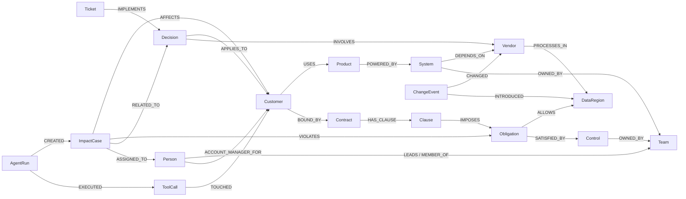

# ClauseRipple

**One clause changes. See what breaks.**

Autonomous change-impact intelligence powered by **FalkorDB**. When a vendor quietly changes one clause, a
ClauseRipple agent walks the company graph — vendor → systems → products → customers → contract obligations
→ owners — decides *deterministically* who is actually in breach, recalls what the company decided last time,
opens an impact case, assigns it to the person who owns the affected system, and shows the evidence for every
step, quoted from the source documents.

> **Vector search finds the changed clause. FalkorDB finds the consequences.**
> And ClauseRipple doesn't stop at finding the consequences — it finds who needs to act and gives them the
> evidence to act.

Built solo for **Graph Hacks: Context for AI Agents** (FalkorDB × WeMakeDevs, Oct 2026) ·
Tracks: **01 Agents That Act on Connected Data** and **03 Company Brain** ·
All data is synthetic (see [Synthetic data](#synthetic-data)).

---

## Contents

[What it does](#what-it-does) · [Why this is a graph problem](#why-this-is-a-graph-problem) ·
[Demo](#demo) · [Agent workflow](#agent-workflow) · [Why FalkorDB is indispensable](#why-falkordb-is-indispensable) ·
[RippleSpace](#ripplespace) · [Graph model](#graph-model) · [Agent tools & MCP](#agent-tools--mcp) ·
[Core Cypher](#core-cypher) · [Decision memory](#decision-memory) · [Source attribution](#source-attribution) ·
[Architecture](#architecture) · [Benchmark](#benchmark) · [What is real](#what-is-real-and-what-is-not) ·
[Tech stack](#tech-stack) · [Local setup](#local-setup) · [Environment variables](#environment-variables) ·
[Demo reset](#demo-reset) · [Tests](#tests) · [Hackathon tracks](#hackathon-tracks) ·
[AI assistance](#ai-assistance-disclosure) · [Synthetic data](#synthetic-data) · [License](#license)

---

## What it does

AtlasAI (fictional) sells AI products to regulated customers. Its vendor **ModelCloud** publishes a new Data
Processing Addendum: §4.1 now lets it process customer data in the **United States** as well as the UAE and EU.

ClauseRipple:

1. **Detects the change** — diffs DPA v1 → v2 and incrementally updates FalkorDB: exactly one new fact,
   `(ModelCloud)-[:PROCESSES_IN]->(United States)`, recorded as a `ChangeEvent`.
2. **Wakes the Change Impact Agent**, which selects graph tools over **MCP** and runs multi-hop Cypher:
   which systems depend on ModelCloud → which products they power → which customers use them →
   which contract clauses bind those customers.
3. **Decides with rules, not vibes** — `violating = vendor regions − allowed regions`, only if a dependency path
   exists:

   | Customer | Verdict | Why (from the graph) |
   |---|---|---|
   | Falcon Bank | **IMPACTED · CRITICAL** | DocSummarizer → Document Processing API → ModelCloud; MSA §7.2 allows UAE/EU only |
   | Acme Insurance | **IMPACTED · CRITICAL** | ClaimsCopilot → Claims Pipeline → ModelCloud; MSA §8.3 allows UAE/EU only |
   | Nova Retail | not impacted | depends on ModelCloud, but MSA §6.2 permits US |
   | GulfGov | not impacted | no path to ModelCloud at all (bounded `shortestPath` returns null) |

4. **Recalls company memory** — finds decision **CR-087** (“Falcon Bank workloads must remain pinned to UAE/EU…”).
5. **Finds the owner** — `System -OWNED_BY-> Team <-LEADS- Person` → Sarah Malik, Platform Engineering.
6. **Acts** — writes `ImpactCase` **CR-104** (Falcon Bank) and **CR-105** (Acme Insurance) into FalkorDB with
   remediation actions whose owners are all resolved from graph relationships, and assigns them.
7. **Explains** — every edge on both paths carries the document, version, line and verbatim quote it came from.
8. **Remembers** — a human approves the remediation; that approval becomes a new `Decision` node that the next
   agent run recalls.

It is not a chatbot over PDFs. The agent's facts come from FalkorDB traversals, its verdicts from deterministic
rules, and its actions are graph writes.

## Why this is a graph problem

“What does ModelCloud's DPA say?” is a retrieval question — vector search answers it.
“**Which customers are now in breach because of it?**” is not in any single document:

```
ModelCloud ─PROCESSES_IN→ US                         (modelcloud_dpa v2 §4.1)
Document Processing API ─DEPENDS_ON→ ModelCloud      (document_processing_architecture)
DocSummarizer ─POWERED_BY→ Document Processing API   (document_processing_architecture)
Falcon Bank ─USES→ DocSummarizer                     (falcon_bank_msa, Schedule A)
Falcon Bank ─BOUND_BY→ MSA ─HAS_CLAUSE→ §7.2 ─IMPOSES→ Residency ─ALLOWS→ {UAE, EU}   (falcon_bank_msa §7.2)
```

The answer lives in the *connections* between five documents, and it is **conditional**: the same vendor change
breaches Falcon Bank, is fine for Nova Retail, and cannot reach GulfGov. Our [benchmark](#benchmark) shows
vector-only retrieval puts the full evidence chain in context for only 2/12 questions at k=5; the graph supports 11/12.

## Demo

Exact click path (≈90 s — full script in [`docs/demo/90-second-script.md`](docs/demo/90-second-script.md)):

1. `Reset demo` → **Baseline · DPA v1**, blast radius “0 impacts”, every customer compliant.
2. Click **Falcon Bank** → *Why?* tab shows the dependency path and §7.2 allowing UAE/EU.
3. Read the DPA diff in the Change panel (`+ … and the United States (US)`), click **Apply ModelCloud DPA v2**.
4. Watch RippleSpace: shockwave from ModelCloud; systems, products, customers and obligations light up in
   traversal order as each real agent tool completes; Falcon Bank and Acme turn red, Nova and GulfGov green.
5. The agent trace shows each MCP tool call with graph reads/writes and FalkorDB time; CR-087 is recalled,
   Sarah Malik found, **CR-104** created and assigned.
6. *Impact cases* → CR-104: owners, actions (pin workloads / review DPA / notify customer within 30 days),
   related memory, evidence documents → **Approve remediation** writes decision **CR-106**.
7. *Evidence graph* tab: the explicit `✕ US not allowed` conflict edge.
8. `Ctrl/Cmd+K` → *“What did we decide about Falcon Bank after the ModelCloud policy change?”* → answered from FalkorDB.

Screenshots: [`docs/demo/screenshots/`](docs/demo/screenshots/).

## Agent workflow

```
DPA v2 lands ──► incremental graph update (+1 fact) ──► ChangeEvent CHG-2026-001
                                                              │
                     Change Impact Agent  (planner: Claude / any OpenAI-compatible LLM / Ollama / deterministic playbook)
                                                              │  list_tools / call_tool  (MCP)
  inspect_change → trace_vendor_dependents → find_impacted_customers → evaluate_residency
      → for each IMPACTED customer: recall_related_decisions → find_owner → get_source_evidence
                                    → create_impact_case (graph write) → assign_impact_case (graph write)
                                                              │
                  AgentRun ─EXECUTED→ ToolCall ─TOUCHED→ entities      (persisted, replayable)
```

- **The LLM chooses tools; tools decide facts; rules decide compliance.** `create_impact_case` re-evaluates the
  residency rule against the live graph and **refuses** if there is no violation — try it from the *Why?* tab on
  Nova Retail. `assign_impact_case` refuses anyone who does not lead/belong to the team that `OWNS` an involved system.
- **Planners** (`apps/api/app/agent/planners.py`): Anthropic Claude (tool use), any OpenAI-compatible endpoint
  (OpenAI, Gemini, Groq, OpenRouter), local Ollama (free), or — when no LLM is configured — a clearly labelled
  **deterministic playbook** that calls the same tools in the same order. The UI always says which one ran.
- **Completeness check:** if an LLM planner stops early, the playbook finishes the missing cases and the trace says
  so. Small local models do stop early (we observed `llama3.2:3b` make four correct tool calls, then narrate).
- **No chain-of-thought is stored** — only tool, input, result summary, entities touched and metrics.

## Why FalkorDB is indispensable

FalkorDB is the only datastore. It holds customers, contracts, clauses, obligations, vendors, systems, products,
regions, controls, teams, people, documents + chunks (with vector embeddings), decisions, tickets, change events,
impact cases, actions, agent runs and tool calls — **and every tool the agent calls is a Cypher query against it,
executed during the reasoning loop.**

| Remove FalkorDB and… | because… |
|---|---|
| the blast radius cannot be computed | `Customer-USES->Product-POWERED_BY->System-DEPENDS_ON*1..4->Vendor` is a live traversal |
| no customer can be classified | allowed regions come from `Contract-HAS_CLAUSE->Clause-IMPOSES->Obligation-ALLOWS->Region` |
| GulfGov cannot be cleared | the “not impacted” proof is a bounded `shortestPath` that returns null |
| cases cannot be assigned | owners are `System-OWNED_BY->Team<-LEADS-Person`; controls and account managers likewise |
| the agent forgets | decisions, cases, approvals and runs are graph nodes recalled by traversal |
| evidence disappears | provenance (doc, version, line, quote) is stored on each relationship |
| RippleSpace goes dark | the 3D view renders the live graph; the ripple order is the traversal depth |
| Ask ClauseRipple can't answer | vector + full-text indexes and the answer paths are all in FalkorDB |

When FalkorDB is down the UI says **“FalkorDB unavailable. Agent reasoning paused.”** — there is no fallback store.

## RippleSpace

A 3D (three.js / react-three-fiber) view of the **live** FalkorDB graph — not a decorative scene.

- **Deterministic semantic layout, three floors:** *dependency chain* (customers → products → systems → vendors),
  *contracts & obligations* below (contracts → clauses → obligations → controls → regions), *organisation & memory*
  above (cases, decisions, tickets, teams, people, agent runs). Nodes in a lane are ordered by the barycentre of
  their structural neighbours, so adding cases never moves the knowledge graph.
- **Data-driven ripple:** the shockwave starts when the real `inspect_change` event arrives; each later tool event
  carries ripple hints (`{id, depth, status}`) computed from FalkorDB path lengths, and nodes light up staggered by
  that depth: ModelCloud (0) → systems (1) → products (2) → customers (3) → obligations (4) → owners/cases.
- Shapes **and** colours encode meaning (never colour alone); amber = changed fact, red = impacted, green = not
  impacted, cyan = owner, violet = recalled memory. Affected-only focus, camera reset/focus/fit, hover labels.
- Demand rendering, capped DPR, reduced-motion support, automatic fallback to a 2D whole-graph view when WebGL is
  unavailable. The 2D **Evidence graph** (React Flow) shows the dependency path and the contract path meeting at the
  regions, with the explicit `✕ US not allowed` conflict edge.

## Graph model



18 node labels (`apps/api/app/graph/ontology.py`): Customer, Product, System, Vendor, DataRegion, Contract, Clause,
Obligation, Control, Team, Person, Decision, Ticket, Document, Chunk, ChangeEvent, ImpactCase, Action, AgentRun,
ToolCall. Every node has a stable `id` (`customer:falcon-bank`); document-derived relationships carry
`src`, `src_ver`, `quote`, `loc`, `line`. Baseline graph: 144 nodes / 173 relationships from 20 documents.

## Agent tools & MCP

The same ten tools are served three ways from one service layer — in-process to the agent through an
**MCP client** (`mcp.Client(mcp_server)`, every agent tool call is an MCP `call_tool`), over **streamable HTTP at
`/mcp`**, and over **stdio** (`uv run python -m app.mcp_server`).

| Tool | Graph work |
|---|---|
| `inspect_change` | ChangeEvent → changed document, entity, introduced/retracted facts |
| `trace_vendor_dependents` | `System-DEPENDS_ON*1..4->Vendor` with provenance |
| `find_impacted_customers` | `Customer→Product→System→Vendor` paths (downstream candidates) |
| `get_customer_obligations` | residency + notification clauses with quotes |
| `evaluate_residency` | deterministic verdict for every customer (+ bounded proof of absence) |
| `recall_related_decisions` | decisions anchored to the customer and/or vendor, ranked |
| `find_owner` | `System-OWNED_BY->Team<-LEADS-Person` |
| `get_source_evidence` | dependency path + contract path + vendor regions, every edge quoted |
| `create_impact_case` | **write** ImpactCase + Actions (guarded: refuses without a graph-verified violation) |
| `assign_impact_case` | **write** ASSIGNED_TO (guarded: assignee must belong to the owning team) |

Connect an external MCP client (e.g. Claude Code) to the running API:

```bash
claude mcp add --transport http clauseripple http://localhost:8000/mcp
```

Read-only tools are annotated `readOnlyHint`; MCP validates every argument against the tool's JSON schema (ids are
pattern-checked) before any Cypher runs.

## Core Cypher

All Cypher lives in [`docs/cypher/`](docs/cypher/) and **is loaded by the API at runtime** — the documented
queries are the executed queries (a test fails if any documented query is unused). Highlights:

```cypher
// 02_customer_blast_radius.cypher — the multi-hop core
MATCH (v:Vendor {id: $vendor_id})
MATCH path = (c:Customer)-[:USES]->(p:Product)-[:POWERED_BY]->(s:System)-[:DEPENDS_ON*1..4]->(v)
RETURN c.name, p.name, s.name, length(path) AS hops,
       [r IN relationships(path) | {type: type(r), src: r.src, quote: r.quote}] AS evidence

// 02 — bounded proof of absence (why GulfGov is safe)
MATCH (c:Customer {id: $customer_id}), (v:Vendor {id: $vendor_id})
WITH c, v
RETURN shortestPath((c)-[:USES|POWERED_BY|DEPENDS_ON*1..6]->(v)) AS path

// 04_owner_lookup.cypher — ownership routing
MATCH (s:System {id: $system_id})-[:OWNED_BY]->(t:Team)
OPTIONAL MATCH (lead:Person)-[:LEADS]->(t)
RETURN t.name, lead.name
```

| File | Purpose |
|---|---|
| `00_schema` | range indexes on every label, full-text (chunks, decisions), vector index (chunks) |
| `01_vendor_dependents` | systems depending on a vendor; vendor processing regions |
| `02_customer_blast_radius` | multi-hop blast radius; bounded `shortestPath` absence proof |
| `03_customer_obligations` | residency / notification obligations per customer and portfolio |
| `04_owner_lookup` | system owners, control owners, account managers, membership guardrail |
| `05_related_decisions` | ranked decision recall; decision memory |
| `06_evidence_path` | dependency + contract evidence paths, documents |
| `07_graph_snapshot` / `08_graph_statistics` | live graph for the UI; real counts |
| `09_ingestion` / `10_change_events` | idempotent upserts, per-document fact delta, ChangeEvents |
| `11_impact_cases` / `12_agent_memory` | the agent's writes: cases, actions, assignment, runs, tool calls |
| `13_validation` / `14_search_and_memory` | post-ingestion checks; vector/full-text search; `algo.betweenness` chokepoints |

## Decision memory

- Prior decisions (CR-087, CR-095, CR-103) and a ticket (PLAT-481) are ingested from decision records into
  `Decision` / `Ticket` nodes linked to customers, vendors, systems, owners and approvers.
- `recall_related_decisions` ranks decisions by shared anchors (customer 2, vendor 1, topic 1): for Falcon Bank it
  returns CR-087, for Acme only a weaker vendor match — so the two cases get different recommendations.
- Approving a remediation writes `(:Decision {origin:'human_approval'})-[:RESOLVES]->(:ImpactCase)` plus
  `APPLIES_TO`/`INVOLVES` — the next run recalls it.
- Every run is stored as `AgentRun-[:EXECUTED]->ToolCall-[:TOUCHED]->entity`; “which runs touched Falcon Bank?” is
  one traversal (`/api/memory/touched-by`). Close the browser, restart the API: cases, decisions and runs are read
  back from FalkorDB.

## Source attribution

Ingestion is deterministic and provenance-first (`apps/api/app/ingest/extractor.py`): canonical entities come from
catalog/CRM/directory documents; relations come from sentence and table rules (`is powered by`, `routes … through`,
`following regions:` …); negated statements (“does not call ModelCloud”) produce no edge. **Every quote is verified
verbatim against its document** before it is written, and 20 critical facts are validated against the live graph
after each reset — if extraction misses one, reset reports a validation failure; nothing is patched in.

## Architecture

```
Browser (Next.js 16 · React 19 · three.js · React Flow)
   │  REST + SSE
FastAPI ── Change Impact Agent (planner) ──MCP client──► ClauseRipple MCP server (10 graph tools)
   │                                                            │
   ├── ingestion: corpus → extractor → fact delta ─────────────┤
   ├── Ask ClauseRipple (graph router + vector/full-text)       │
   └── /mcp (streamable HTTP for external agents)               ▼
                                                          FalkorDB 4.22 (Docker)
```

Details: [`docs/architecture/overview.md`](docs/architecture/overview.md) · judge Q&A: [`docs/JUDGE_PREP.md`](docs/JUDGE_PREP.md).

## Benchmark

`uv run python -m app.eval.benchmark` — 12 questions with ground truth ([`data/evaluation/questions.json`](data/evaluation/questions.json)),
same corpus and chunks for both sides; the vector baseline is in-memory cosine search with the same embedding
model (bge-small-en-v1.5) and never touches FalkorDB. Full table: [`docs/benchmark.md`](docs/benchmark.md).

| Measured (local, this repo) | Graph (FalkorDB) | Vector-only k=5 | Vector-only k=8 |
|---|---|---|---|
| Questions answered exactly | **12/12** | — | — |
| Mean evidence recall (needed sources in context) | **0.99** | 0.37 | 0.62 |
| Questions with complete evidence | **11/12** | 2/12 | 4/12 |

Latency (local Docker, laptop): core blast-radius traversal median **≈1.0 ms** FalkorDB execution (≈4.7 ms wall);
full residency evaluation of all customers ≈19 ms; incremental DPA update ≈0.2 s; full agent run 14 tool calls,
63 graph reads, 13 writes, ≈0.1 s FalkorDB time. Synthetic, small corpus — an illustration of the multi-hop gap,
not a general claim about RAG. Numbers regenerate with the script.

## What is real and what is not

| Real | Simulated / limited |
|---|---|
| FalkorDB graph, every query, every write | Company, people, contracts and vendors are fictional (synthetic corpus) |
| Incremental update from the actual DPA text diff | Extraction is rule-based over a corpus written to be parseable; messy real documents would need the optional LLM/GraphRAG extraction path |
| MCP tool calls (in-process client, `/mcp` HTTP, stdio) | Actions are internal graph records; nothing calls real infrastructure or emails customers (human approval required by design) |
| Deterministic verdicts, guardrails, provenance checks | Without an LLM key the planner is the labelled deterministic playbook |
| Vector + full-text search in FalkorDB (local embeddings) | The UI paces agent steps (450 ms) so humans can follow; measured durations are shown separately |

## Tech stack

FalkorDB 4.22.1 (Docker, bundled FalkorDB Browser) · falkordb-py 1.8 · Python 3.11 · FastAPI 0.143 · MCP Python
SDK 2.3 · Pydantic 2.14 · fastembed 0.9 (local ONNX embeddings) · anthropic 1.14 / openai 3.31 (optional planners) ·
uv · pytest · ruff — Next.js 16.4 · React 19.3 · TypeScript · Tailwind 4.3 · TanStack Query 5 · three 0.186 ·
@react-three/fiber 9 · @react-three/drei 10 · @xyflow/react 12 · lucide-react · Playwright.

## Local setup

Prerequisites: Docker, Python 3.11 + [uv](https://docs.astral.sh/uv/), Node 22 + pnpm.

```bash
git clone https://github.com/bilal-feroz/ClauseRipple && cd ClauseRipple
cp .env.example .env
docker compose up -d falkordb          # FalkorDB :6379 + FalkorDB Browser http://localhost:3001
cd apps/api && uv sync && uv run uvicorn app.main:app --port 8000   # seeds the demo graph on first start
cd apps/web && pnpm install && pnpm dev                              # http://localhost:3000
```

Or with make: `make setup`, `make db`, `make api`, `make web` (see `make help`). Everything in Docker:
`docker compose --profile full up --build`.

Optional LLM planner (the demo works without one): set `LLM_PROVIDER` — e.g. free local
`LLM_PROVIDER=ollama LLM_MODEL=qwen3:4b`, or `LLM_PROVIDER=anthropic` + `ANTHROPIC_API_KEY`, or
`LLM_PROVIDER=gemini` + `LLM_API_KEY` + `LLM_MODEL`.

## Environment variables

See [`.env.example`](.env.example). Key ones: `FALKORDB_HOST/PORT/USERNAME/PASSWORD/GRAPH_NAME`,
`LLM_PROVIDER` (`anthropic|openai|ollama|gemini|groq|openrouter|openai_compatible`, empty = playbook),
`LLM_MODEL`, `LLM_BASE_URL`, `LLM_API_KEY`/`ANTHROPIC_API_KEY`/`OPENAI_API_KEY`, `CORS_ORIGINS`,
`AUTO_SEED`, `AGENT_EVENT_PACING_MS`, `NEXT_PUBLIC_API_URL`. Keys stay server-side; nothing secret reaches the browser.

## Demo reset

`Reset demo` in the UI, `POST /api/demo/reset`, or `make demo-reset`. It drops **only** the `clause_ripple`
graph, re-ingests the v1 corpus, rebuilds indexes and embeddings, validates 20 critical facts and returns the
validation report (≈0.4 s). `make demo-update` applies DPA v2 and runs the agent from the CLI.

## Tests

```bash
cd apps/api && uv run pytest          # unit + integration (real FalkorDB, separate test graph)
cd apps/web && pnpm lint && pnpm typecheck && pnpm build
cd apps/web && pnpm test:e2e          # Playwright: full demo flow against the running stack
```

Covered: residency rules, extractor provenance and negation, every documented query is used, the end-to-end flow
on FalkorDB (baseline → incremental update → agent run → cases persisted and read back by a new client →
guardrails → approval → recall), all API endpoints, input validation, MCP `tools/list` over HTTP, and the UI flow
in a real browser (0 console errors). CI: [`.github/workflows/ci.yml`](.github/workflows/ci.yml).

## Hackathon tracks

- **Track 01 — Agents That Act on Connected Data:** multi-hop reasoning, Cypher queries (and `algo.betweenness`)
  as agent tools, tool selection through MCP, actions driven by graph findings (cases, assignments), explainable
  results with paths and quotes.
- **Track 03 — Company Brain:** contracts, DPAs, architecture docs, directory, controls, decisions and tickets in one
  graph; who owns what; where decisions came from; knowledge kept current by incremental updates; answers with sources.

## AI assistance disclosure

Built with Claude Code as a coding assistant — see [`AI_ASSISTANCE.md`](AI_ASSISTANCE.md) for what was assisted
and what the author designed, reviewed and verified.

## Synthetic data

All organisations, people, products, contracts, tickets and decisions are **fictional** and were written for this
demo ([`data/demo/`](data/demo/)). Any resemblance to real entities — including companies that share a name such
as “ModelCloud” — is coincidental; nothing here describes any real company's terms or behaviour.

## License

MIT — see [`LICENSE`](LICENSE).
