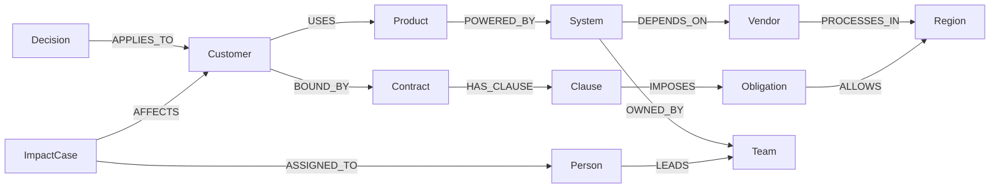

A vendor changes one sentence in its data processing agreement.

Legal can find the sentence. Engineering knows which internal systems call that vendor. Sales knows which customers use which products. Compliance knows which contracts say "your data stays in the EU".

Nobody has the whole chain. So the real question, *"which of our customers are now in breach?"*, usually gets answered weeks later, in a spreadsheet, by whoever drew the short straw.

I built **ClauseRipple** for the Graph Hacks hackathon (FalkorDB x WeMakeDevs) to answer that question in seconds, show the proof, and hand the problem to the person who owns it.

Repo: [github.com/bilal-feroz/ClauseRipple](https://github.com/bilal-feroz/ClauseRipple)


*The main screen after the agent finishes. Left: what changed. Middle: how it spread. Right: who is affected and who needs to act.*

## The one sentence change

The demo world is a fictional company called AtlasAI. It sells AI products to a bank, an insurer, a retailer and a government agency. One of its suppliers is a fictional model provider called **ModelCloud**.

ModelCloud publishes version 2 of its Data Processing Addendum. One sentence in section 4.1 changes:

```diff
- ModelCloud may process Covered Customer Data in the following regions: the United Arab Emirates (UAE) and the European Union (EU).
+ ModelCloud may process Covered Customer Data in the following regions: the United Arab Emirates (UAE), the European Union (EU) and the United States (US).
```

That's it. One new region: the United States.


*Before you apply the change, ClauseRipple shows it in plain words, plus the exact sentence that changed.*

Whether that matters depends on things that are written down in completely different places:

- Which AtlasAI systems send data to ModelCloud? (architecture docs)
- Which products run on those systems? (product catalog)
- Which customers use those products? (contracts and CRM)
- Where does each customer's contract allow its data to go? (a numbered clause in each MSA)
- Who owns the affected system? (the team directory)
- Did we decide anything about this before? (old decision records)

## Why normal RAG is not enough here

Vector search is great at one thing in this story: finding the changed clause. Ask "what changed in ModelCloud's DPA?" and the right chunk comes back.

But "which customers are affected?" is not written in any document. The answer only exists in the **connections** between five of them. For Falcon Bank, two separate chains have to meet:

```text
Does Falcon Bank depend on ModelCloud?
Falcon Bank -USES-> DocSummarizer -POWERED_BY-> Document Processing API -DEPENDS_ON-> ModelCloud

Where may Falcon Bank's data go?
Falcon Bank -BOUND_BY-> MSA -HAS_CLAUSE-> Clause 7.2 -IMPOSES-> Data residency -ALLOWS-> UAE, EU

What changed?
ModelCloud -PROCESSES_IN-> US
```

The first chain says "yes, Falcon Bank's data reaches ModelCloud". The second says "Falcon Bank only allows UAE and EU". Put them next to the new fact and you get a breach.

And the answer is conditional. The exact same change is fine for Nova Retail (its contract allows the US) and can't reach GulfGov at all (none of its products touch ModelCloud). A system that just flags "everyone who mentions ModelCloud" is wrong in both directions.

I measured this. More on the numbers below, but the short version: with plain vector retrieval, the chunks needed to answer the question were all present for only 2 of 12 questions at k=5. Following the graph, 11 of 12.

## The graph

ClauseRipple keeps the whole company in one FalkorDB graph: 20 node labels, built from 20 synthetic source documents. At baseline it's 144 nodes and 173 relationships. Here is the part that matters for this story:



Two chains, one meeting point: the region. Everything else in the product exists to walk these chains, explain them, and act on them.

The graph also stores the agent's own memory: `ChangeEvent`, `ImpactCase`, `Action`, `AgentRun` and `ToolCall` are regular nodes. So "which agent runs touched Falcon Bank?" is just another traversal.

## What ClauseRipple does when the clause changes


*Clicking "Apply the new contract". The agent's steps play out live; Falcon Bank and Acme Insurance turn red.*

1. **Update the graph, not rebuild it.** ClauseRipple diffs DPA v1 against v2 and writes exactly one new fact: `ModelCloud -PROCESSES_IN-> US`, recorded as `ChangeEvent CHG-2026-001`. The incremental update takes about 180 ms locally.
2. **Wake the agent.** The Change Impact Agent calls graph tools over MCP.
3. **Trace the blast radius.** Systems that depend on ModelCloud, products on those systems, customers using those products.
4. **Check every customer with a rule.** More on this below. It's the most important design choice.
5. **Recall company memory.** It finds decision **CR-087**: *"Falcon Bank workloads must remain pinned to UAE/EU processing whenever ModelCloud's regional scope changes."*
6. **Find the owner.** `Document Processing API -OWNED_BY-> Platform Engineering <-LEADS- Sarah Malik`.
7. **Act.** It writes impact cases **CR-104** (Falcon Bank) and **CR-105** (Acme Insurance) into FalkorDB, with next steps, and assigns them.
8. **Explain.** Every step links to the source document and the exact sentence it came from.

The result:

| Customer | Result | Why |
|---|---|---|
| Falcon Bank | Impacted, critical | Reaches ModelCloud via DocSummarizer; contract allows UAE and EU only |
| Acme Insurance | Impacted, critical | Reaches ModelCloud via ClaimsCopilot; contract allows UAE and EU only |
| Nova Retail | Not impacted | Uses ModelCloud, but its contract allows the US |
| GulfGov | Not impacted | No path to ModelCloud at all |

## Why FalkorDB, specifically

I want to be concrete here, because "we used a graph database" can mean anything.

In ClauseRipple, FalkorDB is the only database. There is no Postgres next to it and no separate vector store. Every tool the agent calls is a Cypher query that runs against FalkorDB **during** the agent run. Here is what that means in practice:

- **The blast radius is a live multi-hop traversal.** One variable length pattern (`DEPENDS_ON*1..4`) finds every customer that reaches the vendor, however many internal systems are in between.
- **"Not impacted" is proven, not assumed.** For GulfGov, a bounded `shortestPath` from the customer to the vendor returns nothing. That null is the evidence.
- **Ownership is a traversal.** Who to assign comes from `OWNED_BY` and `LEADS` edges, not from an LLM guessing a name.
- **Memory is graph data.** Past decisions, new impact cases, human approvals and agent runs are nodes, linked to the customers and systems they're about. Restart everything and it's all still there.
- **Evidence lives on the edges.** Every relationship extracted from a document stores the source document, version, line and the verbatim quote.
- **Search is in the same place.** Document chunks are stored with embeddings in a FalkorDB vector index, plus full-text indexes, for the "Ask ClauseRipple" box.
- **The 3D view draws the live graph.** More on that in a minute.

If you take FalkorDB out, ClauseRipple has nothing left to reason with. The UI literally says "FalkorDB unavailable. Agent reasoning paused." because there is no fallback.

Speed was never a concern. On my laptop with FalkorDB in Docker, the core blast radius query has a median of **0.86 ms** of FalkorDB execution time. A whole agent run (14 tool calls, 63 graph reads, 13 graph writes) spends about **75 ms** inside FalkorDB.

## The query at the center of it

All the Cypher lives in plain `.cypher` files in the repo, and the API loads them from there at runtime, so the documented queries are the queries that run. This is the core one:

```cypher
// docs/cypher/02_customer_blast_radius.cypher
MATCH (v:Vendor {id: $vendor_id})
MATCH path = (c:Customer)-[:USES]->(p:Product)-[:POWERED_BY]->(s:System)-[:DEPENDS_ON*1..4]->(v)
RETURN c.id AS customer_id,
       c.name AS customer_name,
       p.id AS product_id,
       p.name AS product_name,
       s.id AS system_id,
       s.name AS system_name,
       length(path) AS hops,
       [n IN nodes(path) | {id: n.id, name: n.name, label: labels(n)[0]}] AS path_nodes,
       [r IN relationships(path) | {type: type(r), src: r.src, src_ver: r.src_ver, quote: r.quote, loc: r.loc, line: r.line}] AS path_edges
ORDER BY customer_name, product_name, system_name
```

In plain English: start at the vendor, find every customer that uses a product, that runs on a system, that depends on the vendor through one to four hops. Return the whole path, its length and, for every edge on the way, the document, version, line and quote it came from.

That last line is what makes the result explainable. The evidence comes out of the same query as the answer.

## The agent: who decides what

This is the part I'm happiest with. ClauseRipple has three layers and each one has one job:

- **The LLM (or planner)** decides which tool to call next and explains the result in words.
- **FalkorDB** stores the facts and walks the relationships.
- **Plain code** decides compliance.

The compliance rule is deliberately boring:

```text
violating regions = vendor processing regions - customer allowed regions
affected          = dependency path exists AND violating regions is not empty
```

For Falcon Bank: `{UAE, EU, US} - {UAE, EU} = {US}`, and a dependency path exists, so it's affected. The LLM never gets asked "is this customer compliant?" It can explain the answer. It can't change it.

The agent has 10 tools, served by an MCP server: `inspect_change`, `trace_vendor_dependents`, `find_impacted_customers`, `get_customer_obligations`, `evaluate_residency`, `recall_related_decisions`, `find_owner`, `get_source_evidence`, `create_impact_case` and `assign_impact_case`. The built-in agent calls them through an MCP client, and the same tools are exposed over HTTP at `/mcp`, so any MCP client can use them.

The two write tools are guarded. `create_impact_case` re-runs the rule against the live graph and **refuses** if there is no violation. There's a button in the UI to try it on Nova Retail; the graph says no. `assign_impact_case` refuses anyone who isn't in the team that owns an affected system.


*Every step the agent took, with what it read from and wrote to the graph.*

One honest note about the "which model" question. The planner is pluggable: Claude, any OpenAI compatible API, or a local Ollama model. If no LLM is configured, a clearly labelled deterministic playbook calls the same tools in the same order. That's what runs in the demo by default, so the demo never depends on an API key or a rate limit.

## RippleSpace: the change you can watch

The 3D view, RippleSpace, is the part people remember. It's built with three.js, React Three Fiber and Drei, with a bloom pass for the glow.

It's not a decorative animation. The nodes and links are the live FalkorDB graph, laid out in floors by meaning: the dependency chain, contracts and obligations, and the organisation and memory layer. When the agent runs, every tool event carries "ripple hints" from the graph: which node, what status, and how many hops it is from ModelCloud. RippleSpace lights nodes up in that order, 170 ms per hop. So the animation follows the same path the impact engine found: ModelCloud, then the systems, then the products, then the customers, then the obligations and owners.


*RippleSpace during the run. Case CR-104 and decision CR-087 have lit up in the memory layer, and the agent is opening CR-105 for Acme Insurance.*

For actually reading the reasoning, there's a 2D evidence graph next to it. It shows Falcon Bank's dependency path and contract path meeting at the regions, with an explicit "US not allowed" edge where they conflict.


*Both chains from the start of this post, drawn from the graph, with the conflict edge in red.*

## From answer to action

Plenty of tools can tell you "Falcon Bank might be affected". I wanted ClauseRipple to do what a good colleague would do next.

So for each impacted customer it finds the affected system, the team that owns it, the person who leads that team and any earlier decision about the same customer. Then it writes a real `ImpactCase` node into FalkorDB, linked to all of them, with next steps that each have an owner: keep workloads pinned to EU/UAE (from CR-087), review the DPA change, and prepare written notice to the customer.


*CR-104 in the UI. The recommended fix comes straight from the earlier decision CR-087.*

When a person clicks "Approve remediation", the approval is written back as a new `Decision` node linked to the case. The next run can recall it. That's the loop I care about: the company's decisions become context for the next change.

## Did the graph actually help? A small benchmark

I didn't want to just claim "graphs beat RAG", so I wrote a small benchmark. It has 12 questions that need facts from more than one document, like "which customers are affected?", "who owns Document Processing API?" and "why is GulfGov not affected?".

Both sides use the same 20 documents, the same chunks and the same embedding model (bge-small-en-v1.5). The vector baseline is plain cosine search and never touches FalkorDB. I measured "evidence recall": how many of the documents needed for the answer ended up in the context.

| | FalkorDB graph | Vector only, k=5 | Vector only, k=8 |
|---|---:|---:|---:|
| Questions answered exactly | 12/12 | n/a | n/a |
| Mean evidence recall | 0.99 | 0.37 | 0.62 |
| Questions with all the evidence | 11/12 | 2/12 | 4/12 |

Please read this for what it is. It's 12 questions on a small synthetic corpus that I wrote, and the vector side isn't tuned per question. It's not a general claim about RAG. What it does show clearly is the shape of the problem: when the answer is spread across relationships, a bigger k drags in more noise before it drags in the right documents.

You can rerun it with `uv run python -m app.eval.benchmark`. The numbers above are from a run today.

## What was hard

**Getting facts out of documents, with proof.** I went with a deterministic, rule based extractor instead of asking an LLM to produce triples. Every relationship stores the exact source sentence, and every quote is checked word for word against the document before it's written. Negative sentences like "does not call ModelCloud" must produce no edge, which sounds obvious until you write the rules. After every reset, 20 critical facts are checked against the live graph. If one is missing, the reset fails loudly instead of quietly patching it. The trade-off is real: my corpus is synthetic and written to be parseable. Messy real contracts would need an LLM extraction step on top.

**Learning FalkorDB's Cypher dialect.** Most things just worked, but a few patterns I'd used elsewhere needed rewrites. Variable length bounds had to be literals, `shortestPath` only works in `WITH` or `RETURN`, and `ORDER BY` after an aggregation has to use the projected columns. None of it was blocking, but I hit each one at least once.

**Small local models and tool calling.** I tried a local `llama3.2:3b` through Ollama on a 4 GB laptop GPU. It made four or five correct tool calls and then started narrating instead of calling the next tool. So the orchestrator has a completeness check: if the planner stops early, the deterministic playbook finishes the missing cases, and the trace says so. That experience is a big reason the compliance decision lives in code and not in the model.

**Making the screen understandable.** My first UI showed everything at once: graph, trace, metrics, badges. It was technically complete and nobody could tell what was happening. The final version tells one story from left to right: what changed, how it spread, who is affected, and below that, why. Making the 3D view readable was its own problem too: label collisions, camera angles, and keeping the glow from hiding the meaning.

## What I learned about graphs

A normal database can store entities. That's not the interesting part.

The interesting part is that the **relationship itself becomes something you can query, carry evidence on, and reason about**. "Falcon Bank uses DocSummarizer" isn't a field on a row. It's a fact with a source, a version and a quote, and the agent can walk across it. Once relationships are first class, "who is affected?" stops being a search problem and becomes a path problem.

## What I learned about agents

Giving an agent more text is not the same as giving it better context.

The agent in ClauseRipple doesn't get a pile of chunks and a prompt that says "figure it out". It gets tools that return specific, connected facts, and a rule it can't override. That constrained design is what makes it trustworthy enough to write cases and assign people. The graph doesn't just inform the agent. It limits what the agent is allowed to do.

## What I'd build next

- Connectors for real sources (contract repositories, Jira, the team directory), so the graph updates itself.
- More kinds of change than data residency: sub-processor changes, notice periods, security controls.
- A "what if" mode: simulate a vendor change before you sign it.

## Try it

Everything runs locally with Docker, Python and Node, and the demo works without any API key:

```bash
git clone https://github.com/bilal-feroz/ClauseRipple
cd ClauseRipple && cp .env.example .env
docker compose up -d falkordb
cd apps/api && uv sync && uv run uvicorn app.main:app --port 8000
# in a second terminal
cd apps/web && pnpm install && pnpm dev
```

Then open http://localhost:3000 and click **Apply the new contract**.

All companies, people and contracts in the demo are fictional. AI coding tools (Claude Code) were used during development for implementation help, debugging and docs; I designed the problem and the graph model, and reviewed and tested the Cypher, the rules, the architecture and the demo behavior. Details are in [AI_ASSISTANCE.md](https://github.com/bilal-feroz/ClauseRipple/blob/main/AI_ASSISTANCE.md).

---

A clause is rarely dangerous on its own. The risk lives in everything connected to it.

That's what ClauseRipple is built to see.
